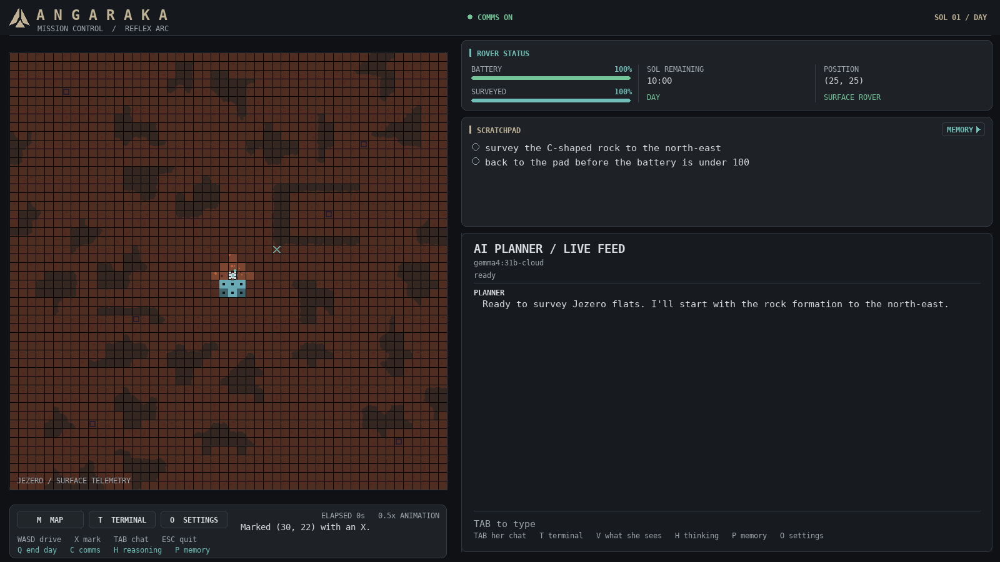

# Prototype 13 — setup

A language model plans for a rover on a Martian plain, you watch it on mission control's
screen, and the real rover can drive every leg. 13 is prototype 11's simulation with prototype
12's rover beside it. What 13 changes is in [`DESIGN.md`](DESIGN.md).

```
prototype13/
  game/        the simulation: prototype 11's
  hardware/    the rover: the Pi's server, the link, and a run_ file per level
```



*The arena fully surveyed so the rocks show, drawn by `game/preview.py`. A mission starts in
fog.*

## The screen

The arena is on the left: 10d's ground, rocks with rounded edges, a black grid, the pad, the
rover, and dust when a storm passes. Under it are buttons for the map, the terminal and the
settings, the keys, the stopwatch, and the world's last three messages. On the right, two
cards sit over her chat: the rover's battery, survey, time left and position; and the
scratchpad, with the objectives, the sites she has found and her own list. Its MEMORY arrow,
or P, flips it to her memory and the board. What she and the rover are doing is the line
under the model's name.

Every key from 10d still works. A button is the same as its key, and a click on the chat's
input line is TAB. M opens the map over the whole window. The window opens filling the
desktop and can be dragged to any size. The map gets the tallest tile that fits and only
the width it needs; the pane gets the rest. Her chat, the
terminal and a setting's value have a caret: left and right move it, Home and End jump, and
backspace and delete work where it is.

## Setup

You need Python 3.12, pygame, and Ollama with a model in it. Every command below runs from
this directory, `prototype13/`.

## Linux

Tested on Linux Mint 22.3 on 11 Oct 2026.

**1. Python and the venv.** `uv` installs without root and fetches its own Python:

```bash
curl -LsSf https://astral.sh/uv/install.sh | sh
uv venv --python 3.12 .venv
uv pip install --python .venv/bin/python -r ../requirements.txt
```

Without uv, Ubuntu and Mint need the venv package first, or `python3 -m venv` fails with
"ensurepip is not available". This route was not tested here, because it needs sudo:

```bash
sudo apt install python3.12-venv
python3 -m venv .venv
.venv/bin/pip install -r ../requirements.txt
```

**2. Ollama and a model.**

```bash
curl -fsSL https://ollama.com/install.sh | sh
ollama pull gemma4:e4b          # 9.6 GB, runs locally
```

The cloud model needs no key. It goes through this machine's own Ollama sign-in:

```bash
ollama signin
ollama pull gemma4:31b-cloud    # registers it; nothing large downloads
```

`ollama list` should now show both.

**3. Check it.** Every suite should end in "passed", or "OK":

```bash
for t in game/test_*.py; do .venv/bin/python "$t" | tail -1; done
(cd hardware/laptop && ../../.venv/bin/python test_level3.py | tail -1)
(cd hardware/pi && ../../.venv/bin/python test_grid.py | tail -1)
```

**4. Run it.**

```bash
.venv/bin/python game/main.py
```

The shipped model is `gemma4:31b-cloud`. If you have not signed in, start with
`--model gemma4:e4b`, or choose it on the settings screen and restart.

## Windows

Written, not yet tested. Use PowerShell, from `prototype13\`:

```powershell
powershell -ExecutionPolicy ByPass -c "irm https://astral.sh/uv/install.ps1 | iex"
uv venv --python 3.12 .venv
uv pip install --python .venv\Scripts\python.exe -r ..\requirements.txt
irm https://ollama.com/install.ps1 | iex
ollama pull gemma4:e4b
ollama signin
ollama pull gemma4:31b-cloud
.venv\Scripts\python.exe game\main.py
```

## Settings

**O** opens the settings screen. Every setting says when a change lands:

- **now:** comms, animation speed, the settling pause, showing the model's reasoning, and
  `MAP_LABELS`, which labels the rover's cell on the map and where a drive is headed.
- **next sol:** the model, the day's length, the battery, the radio's cost, auto objectives,
  the turn caps, the storm, the map format and mission length. The planner is fixed for a
  sol, so these wait for nightfall.
- **after a restart:** the arena, the 50 by default, and the height of the strip under it.

Your changes are saved in `user_settings.json`, which git ignores, and only the ones that
differ from the code's defaults are written. Two presets load whole sets at once:
**29 Sept recording** (what 13 ships with: a 500-step battery and a 600-second day) and
**design** (a 150-step battery, which the work costs were balanced for, and a 200-second
day). Which should be the default has not been decided.

Flags override your saved settings for one launch: `--model`, `--map`, `--arena`,
`--executor`, `--pause`, `--sols`, `--think`, `--comms`, `--objectives`, `--preset`,
`--outage`.

## Running a mission

```bash
.venv/bin/python game/main.py --model gemma4:31b-cloud --sols 5
```

A sol is dawn, day, dusk and night. At dawn and night you talk to her in her chat (TAB); the
day is hers; dusk is her report. `/next` moves to the next phase, and each phase also moves on
60 s after the last thing typed or said. Every command, key, flag and term is in
[`MANUAL.md`](MANUAL.md); `/help` in her chat and `help` in your terminal (T) list them in the
app.

**The day and the battery.** The day lasts `DAY_SECONDS` (600) of wall clock, which nothing
pauses. The battery holds `BATTERY` steps, and only the pad recharges it, overnight; a flat
battery ends the day. A day ended away from the pad strands the rover, and a rover that can
never get home is lost.

**When the cloud drops,** the same request goes to `MODEL_FALLBACK` (`gemma4:e4b`, local), and a
one-token check every 30 s brings the cloud model back. `--outage 2` stages a drop for sol 2.

**ESC always asks before quitting:** K keeps the run in `runs/<stamp>/`, D discards it. A
SIGTERM keeps the run and exits, and a run with no window (`SDL_VIDEODRIVER=dummy`) is kept as
`runs/<stamp>-headless/`. A run with no window never waits for the desk and starts with comms
off.

**Scoring a run.** `.venv/bin/python game/score.py runs/<stamp>` prints a row per sol from
the run's own logs, and several run directories are compared side by side.

**Resuming and replaying.**

```bash
.venv/bin/python game/main.py --resume runs/<stamp> --sols 8
.venv/bin/python game/main.py --replay runs/<stamp>
```

A resumed run wakes on the next sol with the map, her memory, the board, the work and her
reports, under your current settings apart from the arena. Nights saved by 10c do not resume
here. `--sols` is the whole mission's length. A replay
plays a kept run under its own settings, never yours, and halts if the world stops matching.

## The real rover

`hardware/run_level3.py` runs this simulation with the rover driving every leg the planner
drives. Start the rover's server on the Pi first. With no Pi, a fake one in another terminal
prints the motors instead:

```bash
.venv/bin/python hardware/pi/server.py --fake --fast
```

Then:

```bash
.venv/bin/python hardware/run_level3.py --rover 127.0.0.1 --sols 2
```

Leave out `--rover` to find the Pi by the name in `hardware/rover_address.txt`. Every level,
the session on the Pi, taking over from the pad and calibration are in
[`hardware/README.md`](hardware/README.md).
